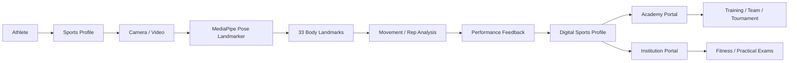

# 🏆 PratibhaScan

## PratibhaScan – AI-Powered Sports Talent Assessment, Development and Discovery
 
> **Repository:** [https://github.com/KUNDRAPU-THARUN/pratibhascan-final](https://github.com/KUNDRAPU-THARUN/pratibhascan-final)

---


## 🧑‍⚖️ Evaluator Quick Start

PratibhaScan is engineered for rapid evaluation by hackathon judges. Here is the fastest path to understanding and exploring the platform:

### 1. What to Understand First
PratibhaScan unifies the sports ecosystem across three primary user roles:
1. **Athlete:** Builds a digital sports identity, records performance drills, receives AI-driven pose analysis, tracks achievements, and discovers opportunities.
2. **Academy:** Manages athlete rosters, coaches, training calendars, team formations, facilities, inventory, medical records, and tournaments.
3. **Institution:** Manages student directories, practical exams, fitness assessments, attendance analytics, and sports programs.

### 2. Recommended Evaluation Flow
```
Athlete Login ──> Create Profile ──> Select Sport ──> Video / Camera Drills ──> MediaPipe 33-Point Pose Analysis ──> Rep Counting & Form Feedback ──> Academy & Institution Discovery / Management
```

---

## 🎯 Problem Statement

1. **Fragmented Talent Discovery:** Grassroots athletes lack standardized digital portfolios to showcase their verified capabilities to scouts and academies.
2. **Subjective Assessment:** Manual physical and skill evaluations can be inconsistent, biased, or lack precise biomechanical metrics.
3. **Disconnected Sports Management:** Academies and educational institutions rely on fragmented paperwork or disconnected tools to track rosters, attendance, and training schedules.
4. **Opportunity Gaps:** Talented individuals in remote or underserved regions struggle to discover trials, tournaments, and scholarships.

---

## 💡 Our Solution

| Problem | PratibhaScan Solution |
|---|---|
| Fragmented athlete profiles | Standardized digital sports profile & multi-sport selection |
| Subjective movement assessment | Computer-vision-assisted analysis via MediaPipe Pose Landmarker |
| Disconnected management | Unified Athlete-Academy-Institution ecosystem |
| Limited opportunity discovery | Built-in academy, tournament, and scouting workflows |
| Scattered achievements | Digital achievement vault & certificate tracking |

---

## ⭐ Innovation & Novelty

PratibhaScan transcends traditional fitness trackers by combining:
- **Computer-Vision-Assisted Assessment:** Objective biomechanical evaluation using 33 body landmarks.
- **Unified Ecosystem:** Seamless connection between individual athletes, training academies, and academic institutions.
- **Performance-to-Opportunity Workflow:** Direct pipelines from performance assessment to academy scouting and tournament registration.
- **Role-Based Management:** Tailored portals for athletes, academies, and institutions without redundant complexity.

---

## 🔄 End-to-End System Workflow



---

## 👥 Three-Role Ecosystem

### 🏃 Athlete
- Digital sports profile & multi-sport registration.
- Video-based performance assessment and live AI coaching.
- Pose analysis with rep counting, form feedback, and score calculation.
- Achievement vault and certificate/badge tracking.
- Tournament discovery and direct application.
- Academy discovery and invitation management.
- Multilingual support.

### 🏫 Academy
- Academy profile management.
- Athlete directory and registration management.
- Coach directory and assignment.
- Team management (squad rosters, positions, captain assignment).
- Facility, inventory, and medical/nutrition tracking.
- Training calendar, attendance, and payroll management.
- Tournament hosting and reporting analytics.

### 🎓 Institution
- Institution profile management.
- Student directory and practical exam/fitness assessments.
- Team management (student rosters, coaching staff).
- Attendance analytics and Fit India / sports analytics integration.
- Parent portal, calendar, and equipment management.

> [!NOTE]
> There are **no separate coach or tournament dashboards**; coach assignment, team building, and tournament coordination are handled natively within the **Academy** and **Institution** portals.

---

## ⭐ Key Features & Implementation Status

| Feature Category | Features | Status |
|---|---|---|
| **Authentication & Users** | Firebase Auth (Email/Password), Role-based navigation, Profile setup | ✅ Implemented |
| **AI & Computer Vision** | MediaPipe Pose Landmarker, CameraX integration, Rep detection, Form feedback | ✅ Implemented |
| **Athlete Dashboard** | Profile management, Achievement vault, Tournament & Academy discovery | ✅ Implemented |
| **Academy Dashboard** | Athlete/Coach directory, Team management, Facilities, Inventory, Medical, Payroll | ✅ Implemented |
| **Institution Dashboard** | Student directory, Practical exams, Fitness assessments, Attendance analytics | ✅ Implemented |
| **Backend & Cloud** | Cloud Firestore, Firebase Storage, Firebase App Check, Analytics | ✅ Implemented |
| **AR Ghost Coach** | Overlay skeleton, pose visualization, real-time guidance | 🟡 Prototype |

---

## 🤖 AI & Computer Vision Pipeline

```
Camera Stream (CameraX)
       ↓
Frame Preprocessing
       ↓
MediaPipe Pose Landmarker (33 3D Body Landmarks)
       ↓
Joint Angle & Trajectory Calculation
       ↓
Rep Detection & Threshold State Machine
       ↓
Form Evaluation & Instant Audio/Visual Feedback
```

- **Pose Landmarks:** Tracks 33 anatomical keypoints (shoulders, elbows, wrists, hips, knees, ankles) to evaluate posture and biomechanics.
- **Reptations Counting:** Algorithmic state machines track movement cycles (e.g., squats, push-ups, drills) with high precision.

---

## 🏗️ System Architecture

```
┌────────────────────────────────────────────────────────┐
│                      Android App                       │
│           Kotlin / Material 3 / ViewBinding            │
└───────────────────────────┬────────────────────────────┘
                            │
            ┌───────────────┴───────────────┐
            ▼                               ▼
    ┌───────────────┐               ┌───────────────┐
    │    CameraX    │               │  Room / Local │
    └───────┬───────┘               └───────────────┘
            ▼
    ┌───────────────────────────────┐
    │  MediaPipe Pose Landmarker    │
    │  (33 Keypoints / Biomechanics)│
    └───────┬────────────────────────┘
            ▼
    ┌───────────────────────────────┐
    │       Firebase Backend        │
    │  (Auth, Firestore, Storage)   │
    └───────────────────────────────┘
```

---

## ☁️ Firebase Architecture

Powered by **Firebase**:
- **Firebase Authentication:** Secure user sign-in and session management.
- **Cloud Firestore:** Real-time NoSQL database storing profiles, teams, rosters, tournaments, and performance records.
- **Firebase Storage:** Secure media storage for athlete videos, certificates, and profile images.
- **Firebase App Check:** Safeguards backend resources against unauthorized client traffic.

---

## 🛠️ Technology Stack

| Layer | Technologies |
|---|---|
| **Mobile Frontend** | Kotlin, Material Design 3, ViewBinding, ConstraintLayout, MPAndroidChart |
| **AI & Computer Vision** | MediaPipe Tasks Vision (Pose Landmarker), CameraX, ML Kit |
| **Local Data** | Room Database, Kotlin Coroutines, KSP |
| **Networking** | Retrofit, OkHttp, Gson, Coil |
| **Backend & Cloud** | Firebase (Auth, Firestore, Storage, Analytics, App Check) |
| **Location & Maps** | Google Play Services Location & Maps |

---

##  Project Structure

```
app/
├── src/
│   └── main/
│       ├── java/com/example/prathibhascanfinal/
│       │   ├── analysis/       # Exercise & sport pose analysis strategies
│       │   ├── data/           # Repositories & data models
│       │   ├── ui/             # Adapters, base classes & UI helpers
│       │   ├── util/           # Utility & manager classes
│       │   └── *.kt            # Activities & ViewModels (Athlete, Academy, Institution)
│       ├── res/                # Layouts, drawables, values, XML configs
│       ├── assets/             # MediaPipe task models (.task files)
│       └── AndroidManifest.xml
├── build.gradle.kts
└── ...
```

---

##  Requirements

- **Android Studio:** Hedgehog / Iguana or newer
- **JDK:** Java 11 (or compatible)
- **Compile SDK:** 36
- **Min SDK:** 24 (Android 7.0+)
- **Target SDK:** 36
- **Device/Emulator:** Android device with camera support (API 24+)

---

##  Installation & Setup

1. **Clone the Repository:**
   ```bash
   git clone https://github.com/KUNDRAPU-THARUN/pratibhascan-final.git
   ```
2. **Open in Android Studio:**
   Open the cloned folder in Android Studio and allow Gradle to sync.
3. **Configure Firebase:**
   - Obtain your `google-services.json` from your Firebase Console.
   - Place `google-services.json` inside the `app/` directory (`app/google-services.json`).
4. **Build & Run:**
   - Connect an Android device or emulator and click **Run**.

---

##  Testing & Verification

- **Manual Testing:** All core workflows (Athlete profiling, AI pose analysis, Academy roster management, Institution student tracking) have been thoroughly tested by the development team.
- **Build Verification:** Verified clean compilation via Gradle (`app:assembleDebug`).

---

##  Security & Compliance

> [!IMPORTANT]
> **Security Notice:** 
> - API keys, private credentials, and `google-services.json` secrets are excluded from version control where applicable via `.gitignore`.
> - Firebase App Check protects backend cloud resources.
> - No plaintext secrets or passwords exist in source code or documentation.

---

##  Impact

- **For Athletes:** Provides a professional digital sports identity and objective performance tracking.
- **For Academies:** Streamlines roster, team, medical, and facility management.
- **For Institutions:** Centralizes student sports records, practical exams, and fitness analytics.

---

##  Limitations

- AI posture analysis accuracy depends heavily on lighting, camera angle, and full-body visibility within the camera frame.
- AR Ghost features operate as an on-device prototype demonstration.
- Cloud synchronization features require an active internet connection.

---

##  Future Scope

- Expansion of sport-specific biomechanical analysis models.
- Enhanced real-time AR coaching feedback overlay.
- Advanced pose analysis
- Offline-first AI inference caching.
- Advanced institutional scholarship and talent recommendation engines.
- Scale More sports + languages
- National Sports authority integration
- National athlete talent network


---

##  Screenshots

Here is a visual walkthrough of the PratibhaScan mobile application interface across its core user workflows:

| **1. Welcome & Landing** | **2. Multi-Role Signup** | **3. Athlete Portal & Arena** |
| :----------------------: | :----------------------: | :---------------------------: |
| *App launch screen with role entry & value proposition.* | *Role-based registration (Athlete, Academy, Institution).* | *Blockchain Verified ID, Impact Score, and active sports arena.* |

| **4. AI Coach Chat** | **5. Live AI Pose Analysis** | **6. Sports Domain & Analytics** |
| :------------------: | :--------------------------: | :------------------------------: |
| *Conversational AI mentor providing personalized insights & plans.* | *Real-time MediaPipe 33-point skeletal tracking & rep counting.* | *Sport categorization, state leaderboard & anti-cheat verification.* |

| **7. Academy & Institution Dashboards** |
| :-------------------------------------: |
| *Administrative portals for managing rosters, facilities, and analytics.* |

---

##   Evaluation Highlights

- **Real-World Impact:** Directly addresses grassroots talent identification and management.
- **Advanced Tech Stack:** Leverages on-device MediaPipe computer vision combined with a cloud-backed Firebase architecture.
- **Comprehensive Scope:** Fully operational three-role ecosystem spanning individual athletes, training academies, and educational institutions.

---

##  Team : Idea Ignites Behind PratibhaScan


- 1. A Veda Amrutha Varashini
- 2. G Kalyani Reddy   
- 3. K Tharun Kumar

##  Repository

- **GitHub:** [https://github.com/KUNDRAPU-THARUN/pratibhascan-final](https://github.com/KUNDRAPU-THARUN/pratibhascan-final)
